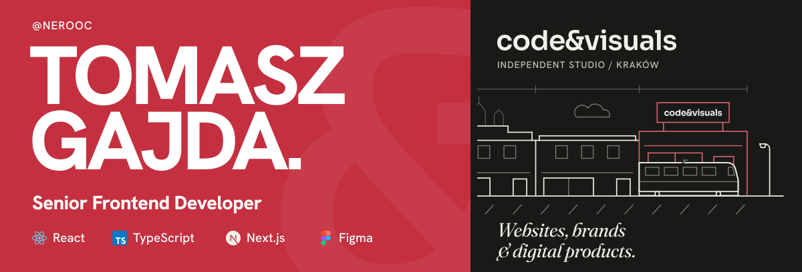
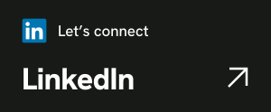
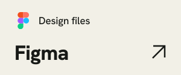
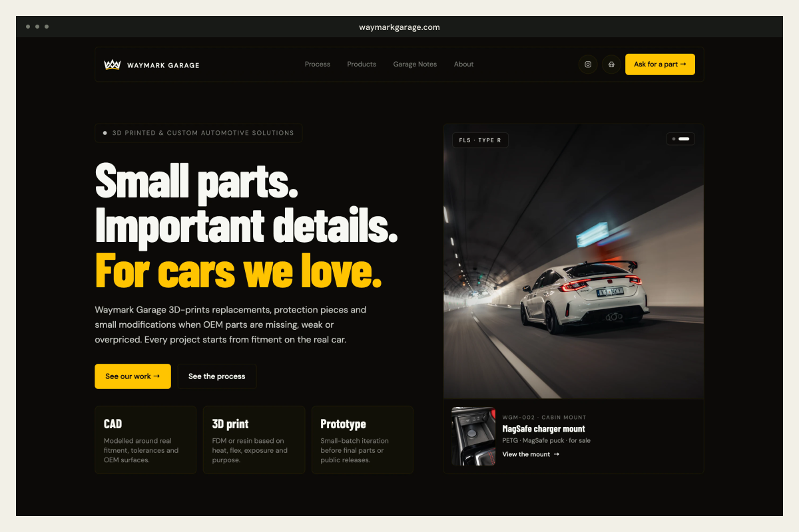
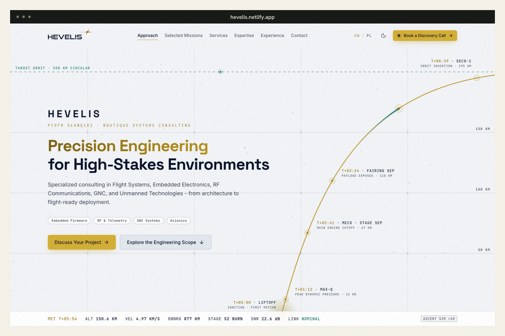
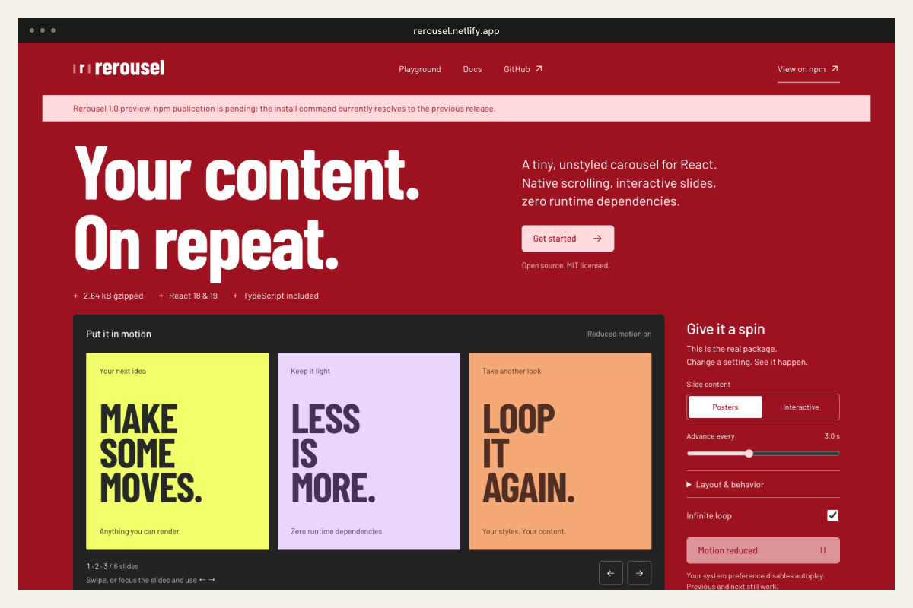
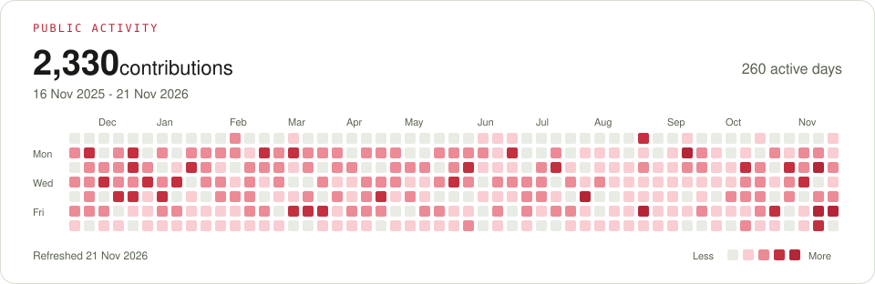

<a href="https://codeandvisuals.dev/en">
  <picture>
    <source media="(max-width: 600px) and (prefers-color-scheme: dark)" srcset="./assets/header-mobile-dark.svg">
    <source media="(max-width: 600px)" srcset="./assets/header-mobile-light.svg">
    <source media="(prefers-color-scheme: dark)" srcset="./assets/header-dark.svg">
    
  </picture>
</a>

<a href="https://codeandvisuals.dev/en"><picture><source media="(max-width: 600px)" srcset="./assets/contact/portfolio-mobile.svg"></picture></a><a href="https://www.linkedin.com/in/gajdat/"><picture><source media="(max-width: 600px)" srcset="./assets/contact/linkedin-mobile.svg"></picture></a><a href="https://www.figma.com/@nerooc"><picture><source media="(max-width: 600px)" srcset="./assets/contact/figma-mobile.svg"></picture></a><a href="mailto:codeandvisuals@gmail.com"><picture><source media="(max-width: 600px)" srcset="./assets/contact/email-mobile.svg"></picture></a>

I’m a **Senior Frontend Developer** building React and TypeScript applications for enterprise teams: banking interfaces, shared components and frontend architecture. I also run **[Code & Visuals](https://codeandvisuals.dev/en)**, where I design brands and build websites.

## Selected work

<table>
<tr>
<td width="50%" valign="top">

<h3>Waymark Garage</h3>

Brand identity and a catalogue for car parts that are missing, hard to find or expensive to replace.

</td>
<td width="50%" valign="top">

<h3>Hevelis</h3>

UX/UI and a bilingual website for aerospace and embedded engineering.

</td>
</tr>
<tr>
<td><a href="https://codeandvisuals.dev/en/portfolio/waymark-garage"><strong>Case study ↗</strong></a> <a href="https://waymarkgarage.com/">Live site ↗</a></td>
<td><a href="https://codeandvisuals.dev/en/portfolio/hevelis"><strong>Case study ↗</strong></a> <a href="https://hevelis.netlify.app/en">Preview ↗</a></td>
</tr>
</table>

<table>
<tr>
<td width="50%" valign="middle">

</td>
<td width="50%" valign="middle">
<h3>Rerousel</h3>

An open-source <strong>React carousel I built at Aexol</strong>. Any JSX, your styles, a small API.

<a href="https://rerousel.netlify.app/"><strong>Try the demo ↗</strong></a> <a href="https://github.com/aexol-studio/rerousel-react-carousel">Source code ↗</a>

</td>
</tr>
</table>

## Tools & current interests

<picture>
  <source media="(max-width: 600px) and (prefers-color-scheme: dark)" srcset="./assets/tools/tools-mobile-dark.svg">
  <source media="(max-width: 600px)" srcset="./assets/tools/tools-mobile-light.svg">
  <source media="(prefers-color-scheme: dark)" srcset="./assets/tools/tools-dark.svg">
  
</picture>

My foundation is **frontend architecture and interface design**. I’m expanding into APIs, databases and cloud delivery.

I use AI throughout development, including **spec-driven development and coding agents**. I turn clear requirements into reviewed, tested changes and stay responsible for what ships. I’m deepening my knowledge of **agentic coding, context engineering and evaluation**, with security and maintainability in view.

## Activity

<a href="https://github.com/nerooc?tab=overview">
  <picture>
    <source media="(max-width: 600px) and (prefers-color-scheme: dark)" srcset="./assets/activity/contributions-mobile-dark.svg">
    <source media="(max-width: 600px)" srcset="./assets/activity/contributions-mobile-light.svg">
    <source media="(prefers-color-scheme: dark)" srcset="./assets/activity/contributions-dark.svg">
    
  </picture>
</a>

## Writing

- [**Stop Breaking My Code!**](https://codeandvisuals.dev/en/blog/stop-breaking-my-code) - the frontend ecosystem and keeping up with change.
- [**Welcome to the Era of ‘Vibe Coding’**](https://codeandvisuals.dev/en/blog/vibe-coding-era) - AI-assisted development and the engineering behind it.

---

Away from the editor: **cars, road trips, and finding the next good view.**
